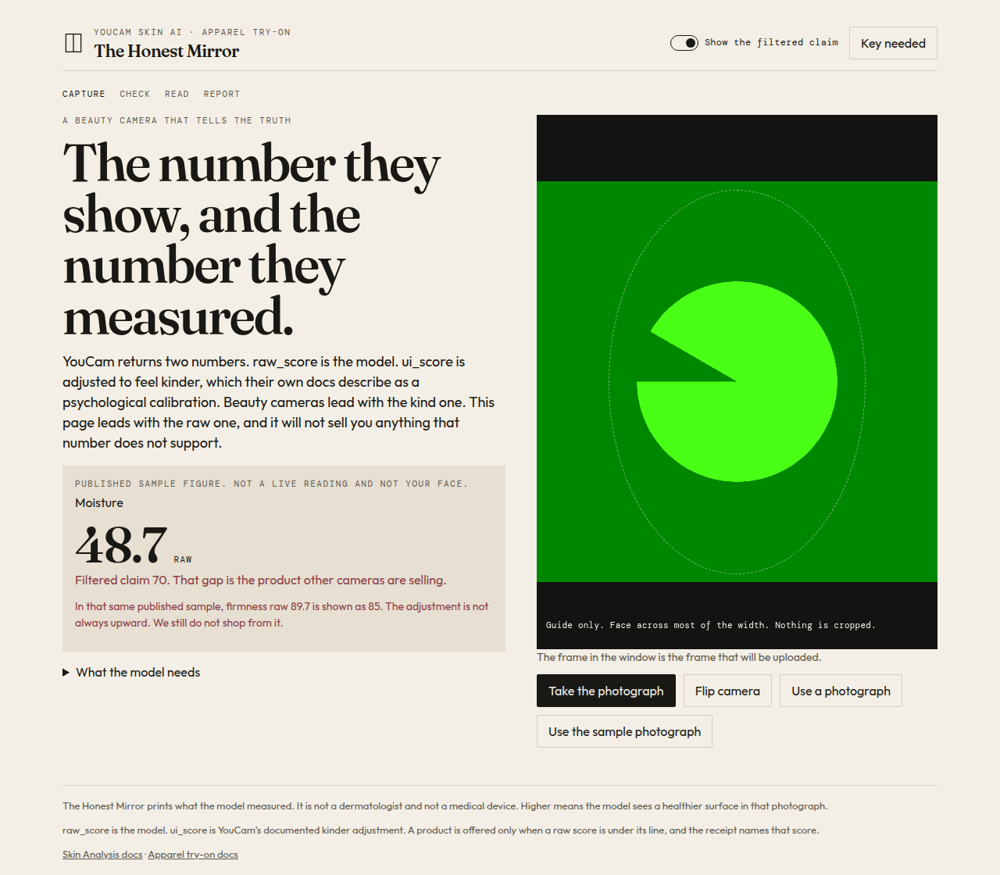
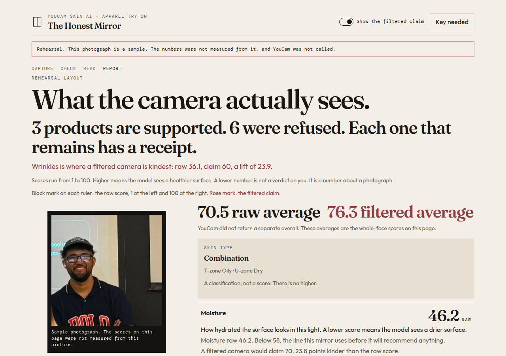
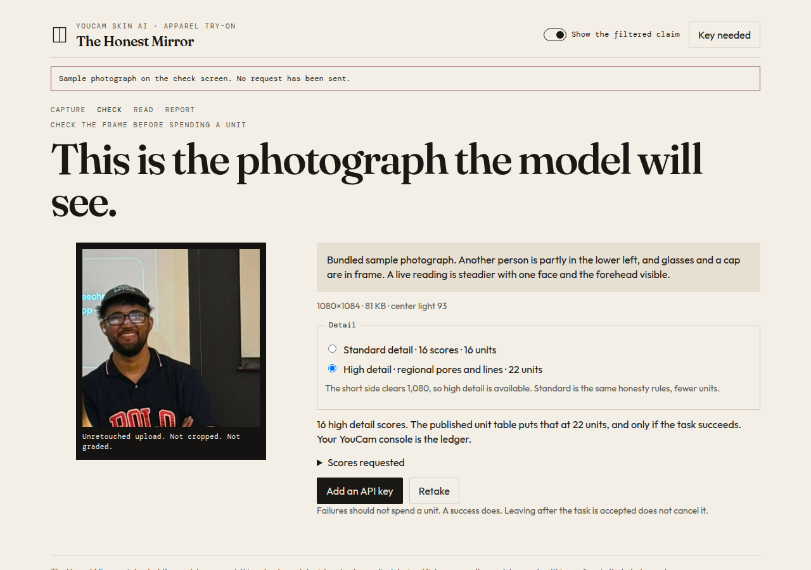
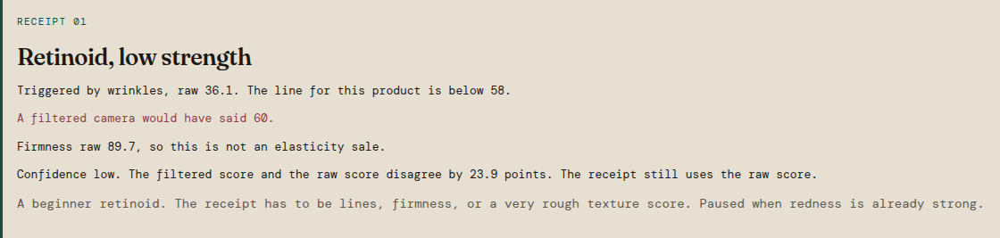
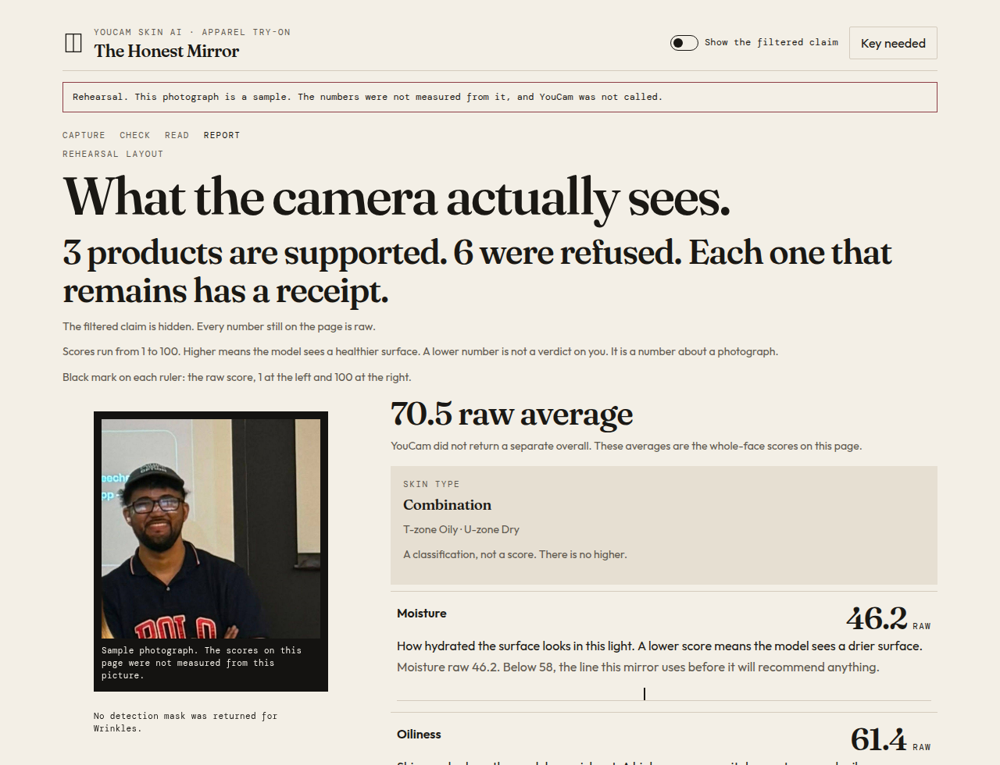
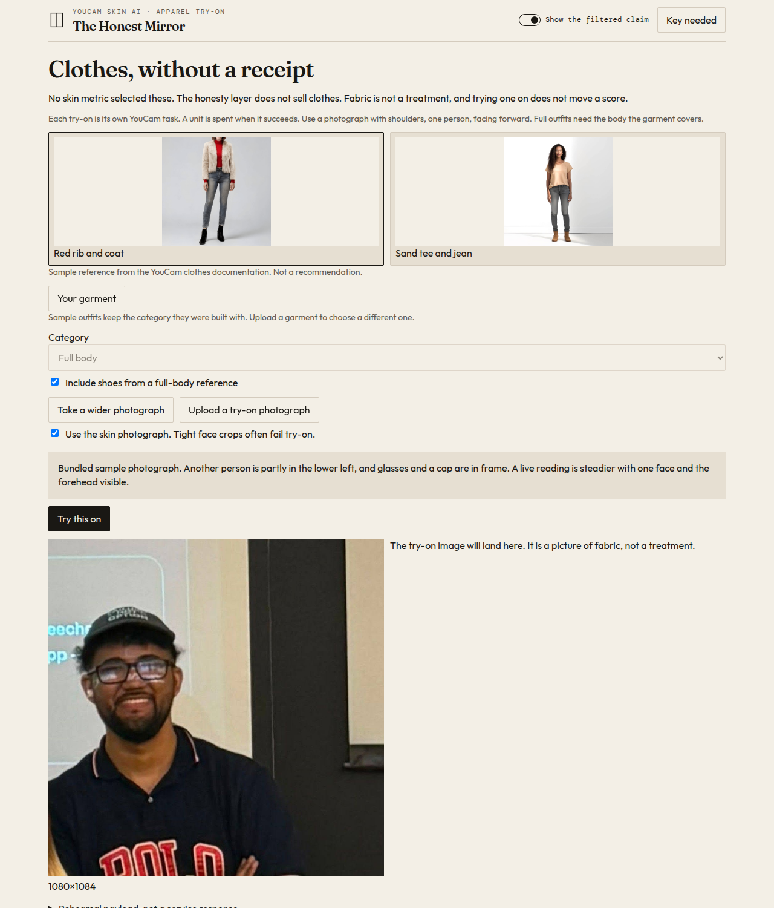
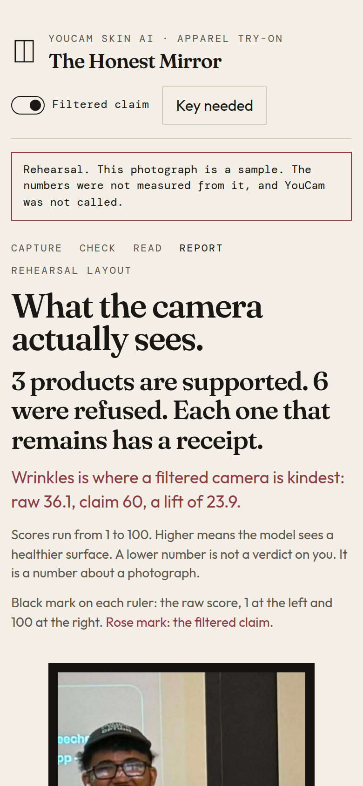

# The Honest Mirror

**A beauty camera that tells the truth.** YouCam Skin AI and Apparel Virtual Try-On, wrapped in an honesty layer: no filters, real skin data, product recommendations only when a raw score is under its line, and a receipt for every claim.

> Entry for the **Perfect Corp YouCam API Skin AI & eCommerce VTO Hackathon** (Devpost). Solo builder: Aaron Grace. Build agent: Cursor (Grok 4.7).

## The pitch

Every beauty camera is a liar. Filters smooth, brighten, and flatter, then you meet the mirror and feel worse. Beauty apps monetize that gap: manufacture insecurity, sell the fix.

**The Honest Mirror inverts the business model.** It shows the photograph unretouched, reads it in plain language, and only recommends a product the raw scores support. Each offer cites the metric that triggered it. If nothing is needed, it says so. The page’s loyalty is to the photograph, not the cart.



The viewfinder in that shot is a live camera. The green shape is the headless test camera used to take the screenshot, not a filter. **Use the sample photograph** loads `assets/sample-portrait.png` through the same path as an upload. It is not a reading until you send it.

## Run it

Static site. No build step, no package install.

```bash
python3 -m http.server 8765
```

Open `http://localhost:8765/`. Any other static server works the same way. Opening `index.html` directly still lets you pick a JPEG or PNG from disk. The camera needs localhost or https, because browsers block `getUserMedia` on `file://`.

### API key

Paste the key from the registration email into `config.js`:

```js
window.HONEST_MIRROR_CONFIG = {
  apiKey: "YOUR_API_KEY",
  apiBase: "https://yce-api-01.makeupar.com",
};
```

Leave the placeholder if you would rather use **Key needed** in the header. That copy is stored in this browser (`localStorage`, key `honestMirror.apiKey`) and overrides `config.js`. Do not commit a real key. The free allotment is 1,000 units. A full reading asks for all 16 concerns: **16 units** at standard detail, **22** at high detail, and only if the task succeeds. The YouCam console is the ledger. This page does not invent a unit count for apparel try-on.

The browser calls `https://yce-api-01.makeupar.com` directly. That host sends `Access-Control-Allow-Origin: *`. The photograph is then PUT to the signed storage URL the file API returns. If that storage host blocks the browser, the page says so and does not pretend the reading happened.

## What you get

1. **Capture.** Front camera is mirrored in the preview and in the pixels that are uploaded, so the file matches what you saw. Nothing is cropped. The long side is limited to 2560 and the JPEG stays under the size cap. Drop a JPEG or PNG, or use the file button. HEIC is refused.
2. **Check.** Short side under 480 blocks a skin reading. Short side of at least 1080 unlocks high detail; you can drop to standard to spend fewer units. HD and SD concern names are never mixed.
3. **Read.** YouCam Skin Analysis (`POST /s2s/v2.0/task/skin-analysis`, then poll). Leaving the page stops the wait. It does not cancel a task the service already accepted. An open task id is kept in `sessionStorage` for 20 hours. **Resume** polls that id and does not start a second one. Going back in the browser does not spend another unit.
4. **Report.** Raw scores, what the model is looking at, and the filtered claim beside them. **Show the filtered claim** hides or reveals `ui_score`. The raw numbers stay. There is no checkout.
5. **Clothes, without a receipt.** Apparel try-on (`POST /s2s/v2.0/task/cloth-v4`) uses a wider photograph (shoulders in frame) and either a documented sample outfit or a garment you upload. Skin scores do not pick the clothes, and a try-on does not move a score.



`?preview=report` draws the report from a labeled rehearsal beside the sample photograph. Those numbers were not measured from that picture, and YouCam is not called. `?preview=check` puts the same photograph on the check screen and sends nothing.



## The two scores

YouCam returns `raw_score` and `ui_score` on a 1–100 scale. Higher means the model sees a healthier surface in that photograph. It is not a moral verdict. `raw_score` is the model. `ui_score` is the documented kinder adjustment (their docs call this a psychological calibration). It often lifts a weak score and sometimes eases a high one down. A published sample, not a face: moisture raw **48.7** shown as **70**, firmness raw **89.7** shown as **85**. This page leads with raw, and it shops only from raw.

Whole-face scores are what a product may cite. A harsh region (the rehearsal nose pores at 29.1, while the whole face is 50) is shown and does not authorize a product for the whole face.



The shelf stops at three offers, lowest raw score first. Anything cut still names the metric. The rules refuse a second moisturizer, a retinoid stacked with acid, a retinoid when redness is already strong, and oil products on dry skin. Eyelids are anatomy, not a product. The names are generic. There are no brands and no prices.

Toggle the filtered claim off and the rose numbers leave. The raw receipt stays.



## Apparel try-on

Sample outfits are Perfect Corp’s own documentation images, loaded by URL so the API does not have to fetch localhost. They are labeled as samples, not recommendations. A skin close-up is the wrong crop. Take a wider photograph, upload one, or explicitly reuse the skin frame and read the warning. The result image is valid for about two hours.



## Tests

```bash
node --test test/honesty.test.js test/youcam.test.js
```

No network. The honesty tests lock the offer and refusal rules, the parser, and the ban on flattery. The client tests cover error sentences and where the try-on image URL is read from.

## Hackathon requirements

- **Both YouCam APIs:** Skin Analysis and Apparel Virtual Try-On.
- **Functional web prototype** in this repo. Vanilla HTML, CSS, and JS. Deployable to GitHub Pages as-is.
- **Public repo:** `AaronGrace978/the-honest-mirror`.
- **1–3 min YouTube demo** still to record. Judges stop watching at 3:00. Script: hook, real skin scan, receipt, try-on, thesis.
- **Deadline: Nov 2, 11:45 AM EST.** Re-verify on the Devpost submission page.
- **Free 1,000 API units.** The key arrives by email. It belongs in `config.js` locally, or in the browser via the key dialog. It is never committed. The original brief mentioned `.env`; this static site has no server, so `config.js` is the equivalent, and the placeholder in git is `YOUR_API_KEY`.

## Judging criteria this is aimed at

1. **Technological Implementation.** Real YouCam calls, task resume so a refresh does not double-spend, and an honesty layer that can refuse a product.
2. **Design.** Calm, paper and ink, no beautification of the photograph.
3. **Potential Impact.** Trust-first beauty commerce.
4. **Quality of Idea.** An agent whose job is to prevent the purchase.

## Deliverables

- [x] Working prototype in this repository
- [ ] Public URL (GitHub Pages or equivalent — not published from this pass)
- [x] README with screenshots of the running UI
- [ ] Devpost submission finished (draft 1265641 has the story and tags)
- [ ] YouTube demo, 3:00 or under

Mobile layout puts the camera, and then the photograph, first.



## Status

- Devpost draft: submission 1265641
- Repo: `AaronGrace978/the-honest-mirror`
- Prototype: `index.html`, `css/styles.css`, `js/app.js`, `js/honesty.js`, `js/youcam.js`, `config.js`
